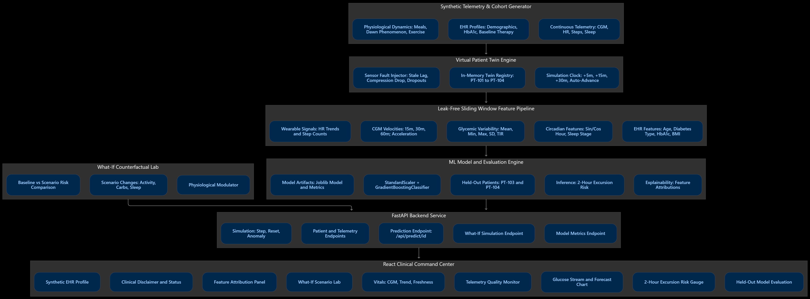

# GlucoTwin AI - Technical Architecture Specification

> **Digital Twin Challenge 2026 | Research Prototype**  
> *Proof-of-Concept Virtual Patient Twin Fusing EHR and Wearable Continuous Telemetry for 2-Hour Glycemic Excursion Forecasting and In Silico Counterfactual What-If Exploration.*

---

## 1. Executive Summary

**GlucoTwin AI** is an in silico healthcare digital twin architecture that integrates longitudinal Electronic Health Record (EHR) profiles with high-frequency continuous glucose monitoring (CGM, 5-minute sampling), continuous heart rate (HR), physical activity step counts, and sleep telemetry.

Its primary predictive objective is estimating the prospective risk of a documented glycemic excursion (**Blood Glucose $\ge 180.0$ mg/dL**) occurring within the next **2 hours (120 minutes)**. Its core differentiator is an interactive **What-If Lab** that enables clinicians and researchers to compute and visualize counterfactual hypothetical trajectories (activity modulation, carbohydrate boluses, circadian sleep disruption) with transparent absolute risk differences ($\Delta$ Risk) and leak-free causal isolation.

---

## 2. End-to-End System Architecture

## 2. End-to-End System Architecture



## 3. Data Flow & Temporal Integrity (Zero Future Leakage)

A foundational flaw in many time-series biomedical models is inadvertent lookahead bias or future data leakage. GlucoTwin AI enforces strict causal boundary isolation:

1. **Prediction Anchor ($t$):** At any given moment $t_i$, the model only accesses historical sensor telemetry up to and including $t_i$ ($t_{i-288} \dots t_i$).
2. **Feature Lookback Window:** Feature extractors compute rolling statistics strictly across $[t_i - 120\text{ min}, t_i]$:
   - Rates of change: $\frac{G(t) - G(t-15)}{15}$
   - Acceleration: $\frac{ROC_{15m}(t) - ROC_{15m}(t-15)}{15}$
   - Rolling moments: $\mu_{1h}, \mu_{2h}, \sigma_{2h}, \min_{2h}, \max_{2h}$
   - Time in target range (TIR 70–180 mg/dL) over the preceding 2 hours.
3. **Prospective Target Horizon ($t \to t+120$ min):** The classification target $Y_i \in \{0, 1\}$ is defined as:
   $$Y_i = \mathbb{I}\left( \max_{k \in [1, 24]} G(t_i + 5k) \ge 180.0 \text{ mg/dL} \right)$$
   During inference and What-If simulation, future telemetry is never inspected.

---

## 4. Machine Learning Pipeline & Out-of-Patient Validation

### 4.1 Cohort Group Partitioning
To evaluate true generalization across diverse diabetic phenotypes, the synthetic cohort is partitioned by **Patient Group**:
- **Training Cohort (10 patients, 19,920 samples):** Patients PT-101, PT-102, PT-105 through PT-112.
- **Held-Out Test Cohort (2 patients, 3,984 samples):** Unseen athletic T1D patient **PT-103** and rotating shift-worker T2D patient **PT-104**.
- **Overlap:** 0% patient overlap between train and test distributions.

### 4.2 Empirical Evaluation Metrics (Held-Out Test Cohort)

| Metric | Empirical Score | Interpretation |
| :--- | :--- | :--- |
| **ROC-AUC** | **0.9529** | High discriminative separation on unseen held-out patients |
| **Precision** | **0.9311** | 93.1% positive predictive value at 0.50 decision threshold |
| **Recall** | **0.7184** | 71.8% sensitivity for detecting prospective excursions |
| **F1 Score** | **0.8110** | Balanced harmonic precision-recall measure |
| **Brier Score** | **0.0475** | Calibration metric (low mean squared probability error) |
| **Train Pos. Rate**| **17.85%** | Naturalistic clinical class balance |
| **Test Pos. Rate** | **17.47%** | Unseen test distribution alignment |

### 4.3 Confusion Matrix (Held-Out Test Cohort)

$$\begin{pmatrix} \text{TN} = 3251 & \text{FP} = 37 \\ \text{FN} = 196 & \text{TP} = 500 \end{pmatrix}$$

---

## 5. In Silico What-If Counterfactual Simulation Engine

The What-If Lab solves the critical clinician challenge: *"What would happen to the patient's prospective risk if they took a 30-minute brisk walk or ingested 60g carbohydrates right now?"*

1. **Baseline Ingestion:** Captures current feature vector $\mathbf{x}_{\text{base}}$ at timestamp $t$.
2. **Physiological Modulation:**
   - Physical Activity: Modulates recent step sums ($\Delta \text{steps} = f(\text{type}, \text{duration})$) and lowers projected rate of change based on patient exercise sensitivity.
   - Carbohydrate Load: Influx of carbs into 1-hour rolling sum, with postprandial glycemic surge scaled by carbohydrate sensitivity ($+0.45$ mg/dL/min per 30g).
   - Circadian Stress: Multiplier on counter-regulatory hepatic output and acute insulin resistance for sleep-deprived states.
3. **Model Re-scoring:** Evaluates the fitted pipeline on the modified feature vector $\mathbf{x}_{\text{scen}}$ to produce $P_{\text{scen}}$.
4. **Absolute Risk Difference ($\Delta$ Risk):**
   $$\Delta \text{Risk} = P_{\text{scen}} - P_{\text{base}}$$
5. **Non-Causal Safety Guardrails:** Discloses that counterfactuals are statistical model associations, not certified medical advice or causal guarantees. Explicitly avoids recommending insulin or medication changes.

---

## 6. Sensor Quality & Safety Gate

Continuous biometric prediction is vulnerable to sensor faults. GlucoTwin AI includes a multi-factor Data Quality engine:

1. **Freshness Monitor:** Flags sensor lag $>15$ minutes as stale.
2. **Continuity Monitor:** Detects packet dropouts in the past 2-hour window.
3. **Physiological Range Verifier:** Flags unphysical sensor spikes ($<40$ or $>400$ mg/dL).
4. **Compression Artifact Detector:** Identifies rapid deep-sleep drops characteristic of nocturnal sensor compression rather than true hypoglycemia.
5. **Confidence Attenuation:** Directly scales the reported model confidence score by the Data Quality score:
   $$\text{Confidence} = \text{Confidence}_{\text{base}} \times \left(\frac{\text{QualityScore}}{100}\right)$$
   When telemetry is degraded, high-risk alerts are tempered with mandatory warnings to avoid false clinician confidence.

---

## 7. Deliverable File Structure

```
d:\Projects\GlucoTwinAI\
├── backend\
│   ├── app\
│   │   ├── api\
│   │   │   ├── routes_patients.py
│   │   │   ├── routes_simulation.py
│   │   │   ├── routes_predict.py
│   │   │   ├── routes_whatif.py
│   │   │   └── routes_metrics.py
│   │   ├── data\
│   │   │   └── generator.py
│   │   ├── ml\
│   │   │   ├── features.py
│   │   │   ├── train.py
│   │   │   └── inference.py
│   │   ├── models\
│   │   │   └── schemas.py
│   │   ├── simulation\
│   │   │   └── engine.py
│   │   ├── config.py
│   │   └── main.py
│   ├── artifacts\
│   │   └── models\
│   │       ├── glucotwin_model.joblib
│   │       ├── metrics.json
│   │       └── pipeline_metadata.json
│   ├── tests\
│   │   ├── test_generator.py
│   │   ├── test_ml_pipeline.py
│   │   └── test_api.py
│   └── requirements.txt
├── frontend\
│   ├── src\
│   │   ├── api\
│   │   │   └── client.ts
│   │   ├── components\
│   │   │   ├── ClinicalDisclaimerBanner.tsx
│   │   │   ├── ClinicianHeader.tsx
│   │   │   ├── VitalsQuickBar.tsx
│   │   │   ├── PatientEHRCard.tsx
│   │   │   ├── GlucoseTimeSeriesChart.tsx
│   │   │   ├── RiskScoreGauge.tsx
│   │   │   ├── ExplainabilityPanel.tsx
│   │   │   ├── WhatIfLab.tsx
│   │   │   ├── DataQualityCard.tsx
│   │   │   └── ModelEvaluationModal.tsx
│   │   ├── types\
│   │   │   └── index.ts
│   │   ├── __tests__\
│   │   │   ├── setup.ts
│   │   │   └── dashboard.test.tsx
│   │   ├── App.tsx
│   │   ├── index.css
│   │   └── main.tsx
│   ├── package.json
│   ├── tailwind.config.js
│   ├── vite.config.ts
│   └── vitest.config.ts
├── scripts\
│   ├── run_backend.ps1
│   ├── run_frontend.ps1
│   ├── train_model.ps1
│   ├── run_tests.ps1
│   └── run_all.ps1
├── ARCHITECTURE.md
├── PRESENTATION.md
├── DEMO_WALKTHROUGH.md
├── README.md
├── LICENSE
└── package.json
```
